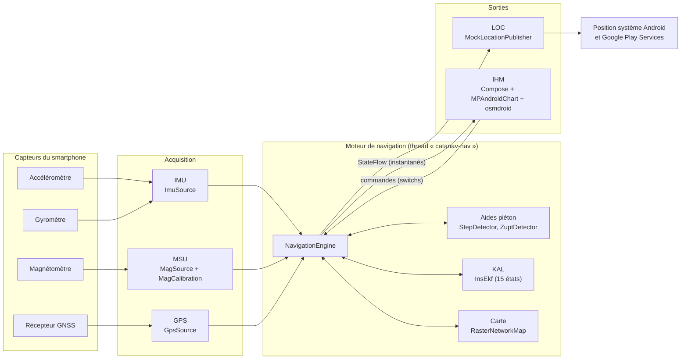
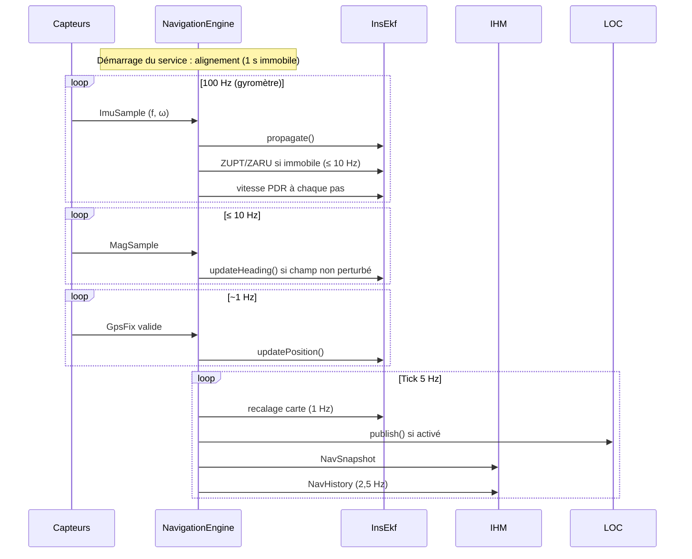

# CataNav — Spécification 00 : architecture générale

| | |
|---|---|
| **Application** | CataNav — localisation inertielle piéton hybridée |
| **Plateforme** | Android 14+ (API 34), Kotlin, Jetpack Compose |
| **Package** | `fr.inertialnav.iau` |
| **Paramètres** | `config/Params.kt` (tous les réglages, commentés) |
| **Documents liés** | 01 IMU · 02 MSU · 03 GPS · 04 Aides piéton · 05 KAL · 06 Carte · 07 LOC · 08 IHM · 09 Moteur et service |

---

## 1. Objet

CataNav estime en continu la position, la vitesse et l'attitude d'un piéton portant un smartphone, y compris là où le GNSS est indisponible (souterrains, catacombes de Paris). Le cœur est une **navigation inertielle à composants liés** (*strapdown*) : les accéléromètres et les gyromètres sont intégrés. Cette solution dérive rapidement avec des capteurs MEMS ; elle est donc **hybridée** par un filtre de Kalman avec toutes les informations disponibles :

| Source | Information apportée | Module |
|---|---|---|
| Magnétomètre | azimut (cap) | MSU |
| GNSS | latitude, longitude, altitude | GPS |
| Détection de pas | norme et direction de la vitesse | Aides piéton (PDR) |
| Immobilité | vitesse nulle, vitesse angulaire nulle | Aides piéton (ZUPT / ZARU) |
| Plan des galeries | appartenance au réseau praticable | Carte |

La position hybridée est affichée, et elle peut être **publiée comme position système** : les autres applications (Google Maps…) la voient alors à la place de la position GNSS (module LOC).

## 2. Découpage en modules

| Module | Package | Rôle | Spécification |
|---|---|---|---|
| IMU | `imu` | Acquisition accéléromètre + gyromètre, passage au repère FRD | 01 |
| MSU | `msu` | Magnétomètre, compensation fer dur / fer doux, cap, calibration | 02 |
| GPS | `gps` | Filtrage des positions GNSS (validité, fraîcheur) | 03 |
| Aides piéton | `pedestrian` | Détection de pas (PDR), détection d'immobilité (ZUPT) | 04 |
| KAL | `kal` | Mécanisation inertielle et filtre de Kalman étendu à erreur d'état | 05 |
| Carte | `map` | Réseau praticable géoréférencé, appariement au point le plus proche | 06 |
| LOC | `loc` | Publication de la position hybridée (positions fictives Android / Play Services) | 07 |
| IHM | `ihm` | Écrans Moniteur, Carte, Commande, Boussole, Calibration | 08 |
| Moteur et service | `engine`, `service` | Orchestration, thread de navigation, service au premier plan | 09 |
| Socle | `core.math`, `core.geo`, `config` | Vecteurs, matrices, quaternions, plan tangent local, paramètres | — |

## 3. Schéma architectural

## 4. Schéma de flux global

## 5. Conventions communes

### 5.1 Repères

| Repère | Définition | Usage |
|---|---|---|
| **Capteur Android** | x droite, y haut de l'écran, z sortant de l'écran | Valeurs brutes `SensorEvent` |
| **Porteur FRD** (*body*) | x avant (haut de l'écran), y droite, z bas (vers le dos du téléphone) | Toute la navigation |
| **Navigation NED** | x Nord, y Est, z Bas, plan tangent local centré sur l'origine | Position, vitesse, attitude |
| **WGS84** | latitude, longitude (°), hauteur (m) | Entrées / sorties géographiques |

Passage Android → FRD (rotation propre, déterminant +1) :

$$
\mathbf{v}_{FRD} = \begin{pmatrix} 0 & 1 & 0 \\ 1 & 0 & 0 \\ 0 & 0 & -1 \end{pmatrix} \mathbf{v}_{Android}
$$

### 5.2 Attitude

L'attitude est le quaternion de Hamilton $q_{nb}$, qui fait passer du repère porteur au repère de navigation : $\mathbf{v}_n = C_{nb}\,\mathbf{v}_b$. Les angles d'Euler suivent la convention aéronautique ZYX (lacet $\psi$, tangage $\theta$, roulis $\phi$) :

$$
C_{nb} = R_z(\psi)\,R_y(\theta)\,R_x(\phi), \qquad
\phi = \operatorname{atan2}(C_{32}, C_{33}),\;
\theta = -\arcsin(C_{31}),\;
\psi = \operatorname{atan2}(C_{21}, C_{11})
$$

### 5.3 Temps

Tous les horodatages sont en nanosecondes sur la base `elapsedRealtimeNanos` (horloge monotone, qui continue pendant la veille). C'est la base des `SensorEvent.timestamp` et de `Location.elapsedRealtimeNanos`, ce qui permet de comparer directement capteurs et GNSS.

### 5.4 Unités

SI partout : m, m/s, m/s², rad, rad/s, s ; champ magnétique en µT. Les degrés n'apparaissent qu'aux interfaces (IHM, WGS84).

## 6. Modèle d'exécution

- **Un seul thread de navigation** (`HandlerThread` « catanav-nav ») reçoit tous les callbacks (capteurs, GNSS) et exécute le filtre. Aucun verrou n'est nécessaire sur l'état du filtre : c'est le choix le plus sûr pour un filtre de Kalman, dont l'état et la covariance doivent évoluer de façon atomique.
- **L'IHM ne lit que des instantanés immuables** (`NavSnapshot`, `NavHistory`, `CalibrationView`) publiés via `StateFlow`.
- **Service au premier plan** de type `location` avec verrou de veille partiel : la navigation continue écran éteint (spécification 09).

## 7. Exigences générales

| Id | Exigence |
|---|---|
| G-1 | La navigation fonctionne sans GNSS ni réseau (seules les tuiles OpenStreetMap nécessitent Internet). |
| G-2 | Chaque hybridation (magnétomètre, GPS, carte, PDR, ZUPT, LOC) est activable / désactivable en cours de navigation, sans redémarrage. |
| G-3 | Toute mesure incohérente avec l'état estimé est rejetée par un test du χ² (risque 0,1 %). |
| G-4 | La position publiée ne doit jamais être réinjectée comme mesure GNSS (pas de boucle). |
| G-5 | L'IHM affiche l'incertitude (±3σ) de chaque grandeur estimée. |
| G-6 | Tous les réglages sont centralisés dans `config/Params.kt`. |

## 8. Dépendances externes

| Bibliothèque | Usage | Justification |
|---|---|---|
| Jetpack Compose, Material 3 | IHM | Standard Android actuel |
| MPAndroidChart 3.1.0 (JitPack) | Courbes temporelles | Choix utilisateur ; rendu performant de séries longues |
| osmdroid 6.1.20 | Carte, tuiles hors ligne | OpenStreetMap sans clé d'API, tuiles embarquées possibles |
| play-services-location 21.3.0 | Mode fictif du Fused Location Provider | Seul moyen d'alimenter Google Maps (spécification 07) |

## 9. Vérification

Les tests unitaires (`app/src/test`) couvrent le socle mathématique, KAL, MSU, les aides piéton et la carte. Ils s'exécutent sur la JVM, sans appareil. Les modules dépendants d'Android (acquisition, LOC, IHM) ne sont vérifiables que sur un appareil réel.
