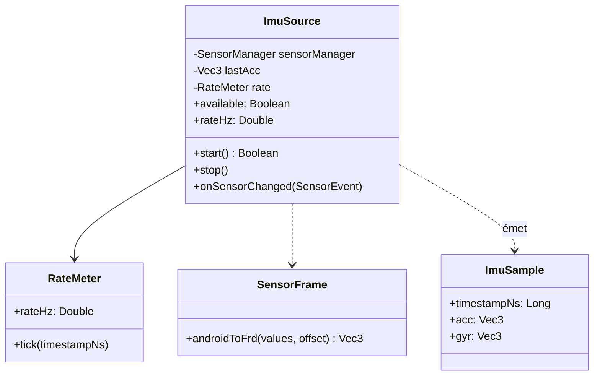
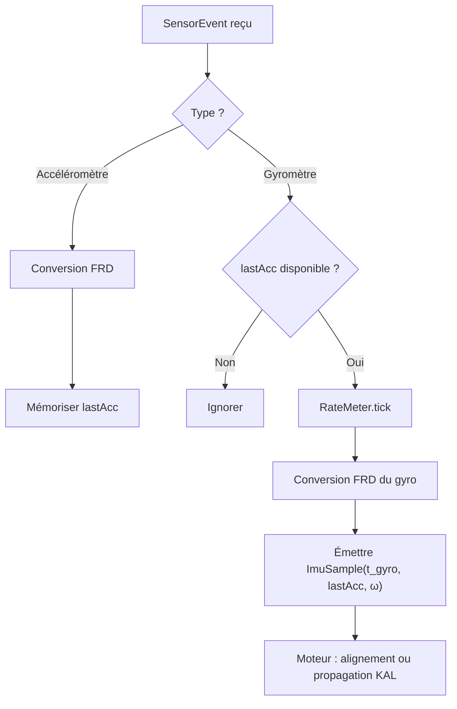

# CataNav — Spécification 01 : module IMU (acquisition inertielle)

| | |
|---|---|
| **Package** | `fr.inertialnav.iau.imu` |
| **Classes** | `ImuSource`, `ImuSample`, `RateMeter` ; `core.math.SensorFrame` |
| **Paramètres** | `Params.Imu`, `Params.Engine.IMU_HISTORY_*` |
| **Consommateurs** | Moteur (spécification 09) → KAL (05), Aides piéton (04) |

---

## 1. Rôle

Le module IMU acquiert les mesures de l'accéléromètre et du gyromètre du smartphone, les synchronise, les exprime dans le repère porteur FRD et les transmet au moteur de navigation sous forme d'échantillons `ImuSample` horodatés.

## 2. Description détaillée

### 2.1 Capteurs utilisés

| Capteur Android | Grandeur | Unité | Remarque |
|---|---|---|---|
| `TYPE_ACCELEROMETER` | force spécifique $\tilde{\mathbf f}$ (inclut la réaction à la pesanteur) | m/s² | Au repos, à plat : $(0, 0, +9{,}81)$ en repère Android |
| `TYPE_GYROSCOPE` | vitesse angulaire $\tilde{\boldsymbol\omega}$ | rad/s | Version « calibrée » d'Android (dérive compensée en partie) |

Les deux capteurs sont enregistrés à la même période, `Params.Imu.SAMPLING_PERIOD_US` (10 000 µs, soit 100 Hz), sans latence de regroupement (`maxReportLatencyUs = 0`). Les callbacks arrivent directement sur le thread de navigation (`Handler` fourni par le moteur).

### 2.2 Synchronisation

Le **gyromètre cadence la sortie**. À chaque mesure gyro, un échantillon est émis avec la **dernière mesure accéléromètre reçue**. Aucun échantillon n'est émis tant qu'aucune mesure accéléromètre n'est disponible.

### 2.3 Changement de repère

Chaque vecteur est converti par `SensorFrame.androidToFrd` (voir spécification 00 §5.1) :

$$
\mathbf v_{FRD} = (v_y,\; v_x,\; -v_z)_{Android}
$$

### 2.4 Mesure de fréquence

`RateMeter` estime la fréquence effective par une moyenne exponentielle de la période ($\alpha = 0{,}02$), en ignorant les intervalles aberrants (> 1 s) :

$$
\bar T_k = 0{,}98\,\bar T_{k-1} + 0{,}02\,(t_k - t_{k-1}), \qquad f = 1/\bar T_k
$$

### 2.5 Historique pour l'IHM

Le moteur moyenne les échantillons par paquets de `IMU_HISTORY_DECIMATION` (4, soit 100 Hz → 25 Hz) avant de les historiser (forces spécifiques et vitesses angulaires affichées dans le Moniteur). Il en déduit aussi la **verticale mesurée** affichée dans la Boussole :

$$
\hat{\mathbf d}_b = -\frac{\bar{\mathbf f}_b}{\lVert \bar{\mathbf f}_b \rVert} \qquad (\text{si } \lVert \bar{\mathbf f}_b\rVert > 1\ \text{m/s}^2)
$$

## 3. Interfaces

| Sens | Élément | Contenu |
|---|---|---|
| Entrée | `Context`, `Handler` | Accès au `SensorManager`, thread de réception |
| Sortie | `onSample(ImuSample)` | `timestampNs`, `acc` (FRD, m/s²), `gyr` (FRD, rad/s) |
| Sortie | `rateHz` | Fréquence effective, pour l'IHM |
| Sortie | `available` | Présence des deux capteurs |

## 4. Schéma architectural

## 5. Schéma de flux

## 6. Modèle de mesure

Le modèle d'erreur retenu (utilisé par KAL, spécification 05) est :

$$
\tilde{\mathbf f}_b = \mathbf f_b + \mathbf b_a + \mathbf w_a, \qquad
\tilde{\boldsymbol\omega}_b = \boldsymbol\omega_b + \mathbf b_g + \mathbf w_g
$$

- $\mathbf w_a, \mathbf w_g$ : bruits blancs de densités $\sigma_a$ (`Kal.ACC_NOISE_DENSITY`) et $\sigma_g$ (`Kal.GYRO_NOISE_DENSITY`) ;
- $\mathbf b_a, \mathbf b_g$ : biais lentement variables, modélisés en marches aléatoires et estimés par KAL.

Les facteurs d'échelle, les défauts d'orthogonalité et la sensibilité à la température ne sont pas modélisés.

## 7. Justifications

| Choix | Justification |
|---|---|
| 100 Hz | Le pas humain a une énergie jusqu'à ~10 Hz ; 100 Hz respecte largement Shannon tout en limitant la charge CPU du filtre (propagation 15×15 à chaque échantillon). Au-delà de 200 Hz, Android exige la permission `HIGH_SAMPLING_RATE_SENSORS`. |
| Gyromètre comme horloge | L'intégration de l'attitude est l'étape la plus sensible aux erreurs d'échantillonnage. Elle doit utiliser chaque mesure gyro avec son horodatage exact. |
| Accéléro « dernière valeur » | Les deux capteurs ont la même période ; le décalage maximal (≤ 10 ms) est négligeable devant la dynamique de marche. Une interpolation n'apporterait pas de gain mesurable. |
| Capteurs « calibrés » Android | Le gyro non calibré présente des biais de plusieurs mrad/s. La version calibrée en retire une partie ; le résidu est estimé par KAL. |
| Repère FRD | Convention aéronautique standard, cohérente avec NED et les formules de mécanisation classiques. |

## 8. Limites et évolutions

- Pas de compensation du décalage temporel entre accéléromètre et gyromètre.
- Calibration d'usine supposée correcte (échelle, orthogonalité). Une calibration 6 positions pourrait être ajoutée.
- Option possible : `TYPE_GYROSCOPE_UNCALIBRATED`, pour maîtriser entièrement l'estimation du biais.

## 9. Vérification

- `MathTest` : changement de repère et rotations.
- `InsEkfTest.staticAlignmentRecoversRollPitch` : cohérence entre la force spécifique au repos et l'alignement.
- Sur appareil : la fréquence affichée dans l'onglet Commande doit être proche de 100 Hz.
