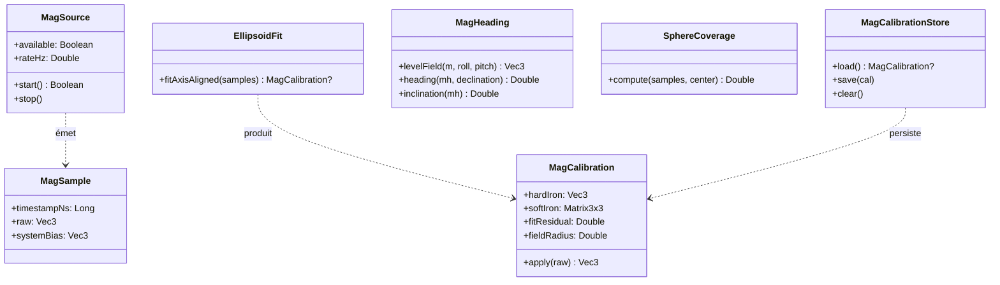
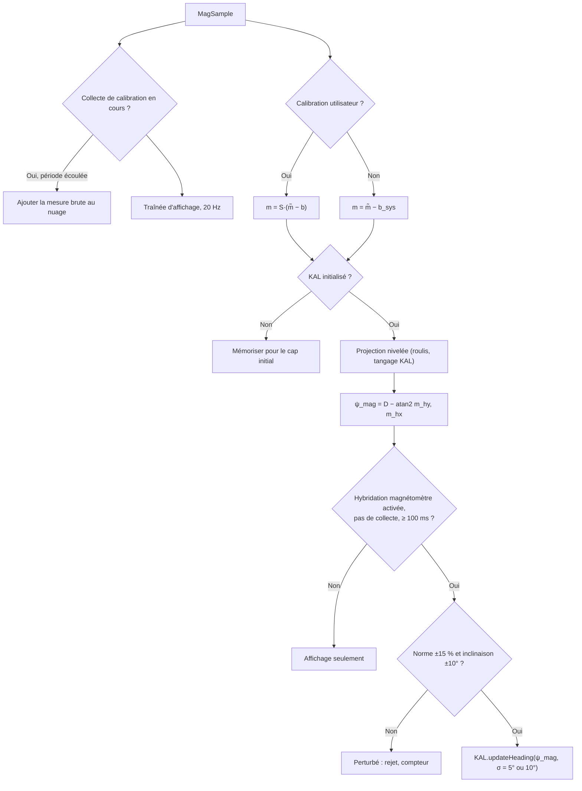

# CataNav — Spécification 02 : module MSU (magnétomètre)

| | |
|---|---|
| **Package** | `fr.inertialnav.iau.msu` |
| **Classes** | `MagSource`, `MagSample`, `MagCalibration`, `EllipsoidFit`, `MagHeading`, `SphereCoverage`, `MagCalibrationStore` |
| **Paramètres** | `Params.Msu` |
| **Consommateurs** | Moteur → KAL (recalage de cap), IHM (Boussole, Calibration) |

---

## 1. Rôle

Le module MSU acquiert le champ magnétique et le compense des effets de **fer dur** (aimantation permanente du téléphone) et de **fer doux** (déformation du champ par les matériaux ferromagnétiques). Il en déduit l'**azimut** compensé de l'inclinaison, qui sert de mesure de cap au filtre de Kalman. Il fournit aussi l'outil de calibration et sa visualisation.

## 2. Description détaillée

### 2.1 Acquisition

- Capteur préféré : `TYPE_MAGNETIC_FIELD_UNCALIBRATED`. Il donne le champ brut $\tilde{\mathbf m}$ (valeurs 0–2) et le biais de fer dur estimé par Android $\mathbf b_{sys}$ (valeurs 3–5).
- Repli : `TYPE_MAGNETIC_FIELD` (déjà compensé par Android, $\mathbf b_{sys} = 0$).
- Période : `Msu.SAMPLING_PERIOD_US` (20 ms, soit 50 Hz). Conversion en repère FRD comme l'IMU.

### 2.2 Compensation

Deux niveaux, par ordre de priorité :

1. **Calibration utilisateur** (si elle existe) : $\mathbf m = S\,(\tilde{\mathbf m} - \mathbf b)$.
2. **Calibration système** : $\mathbf m = \tilde{\mathbf m} - \mathbf b_{sys}$.

### 2.3 Calibration utilisateur (ajustement d'ellipsoïde)

Pendant la collecte, l'utilisateur fait tourner le téléphone dans toutes les orientations. Les mesures brutes sont échantillonnées à 20 Hz (`CALIBRATION_SAMPLE_PERIOD_NS`), jusqu'à 3000 (`CALIBRATION_MAX_SAMPLES`). Sans perturbation, elles décrivent un ellipsoïde ; l'ajustement estime son centre et ses demi-axes.

Un ajustement provisoire est recalculé toutes les secondes (`CALIBRATION_PREVIEW_EVERY_TICKS`) pour la visualisation en direct. À la fin, la calibration n'est retenue que si le résidu relatif est inférieur à `CALIBRATION_MAX_RESIDUAL` (10 %). Elle est alors enregistrée (`SharedPreferences`) et rechargée à chaque démarrage.

### 2.4 Rejet des perturbations

Les masses métalliques (rails, armatures, portes) faussent localement le champ. Avant chaque recalage, deux tests comparent la mesure au modèle géomagnétique mondial (WMM, via `android.hardware.GeomagneticField`, évalué à l'origine de navigation) :

$$
\frac{\big|\,\lVert\mathbf m\rVert - F_{WMM}\big|}{F_{WMM}} < 15\,\% \qquad\text{et}\qquad
|I_{mes} - I_{WMM}| < 10°
$$

Tant que l'origine est inconnue, $F_{WMM}$ vaut `DEFAULT_FIELD_UT` (48 µT) et le test d'inclinaison est omis.

### 2.5 Couverture de la sphère

Pour guider l'utilisateur, la sphère des directions $(\mathbf m - \mathbf c)/\lVert\mathbf m - \mathbf c\rVert$ est découpée en 4 bandes d'égale aire (selon $z$) × 8 secteurs d'azimut, soit 32 cases d'égale surface. La couverture est la proportion de cases contenant au moins une mesure.

## 3. Équations des modèles

### 3.1 Modèle de mesure magnétique

$$
\tilde{\mathbf m}_b = S^{-1}\, C_{bn}\, \mathbf m_n + \mathbf b + \mathbf w_m
$$

avec $\mathbf m_n = F\,(\cos I\cos D,\; \cos I \sin D,\; \sin I)^T$ le champ terrestre en NED ($F$ intensité, $I$ inclinaison, $D$ déclinaison).

### 3.2 Ajustement d'ellipsoïde à axes alignés

Après centrage sur la moyenne $\bar{\mathbf m}$ ($\mathbf p = \tilde{\mathbf m} - \bar{\mathbf m}$), on résout au sens des moindres carrés :

$$
A p_x^2 + B p_y^2 + C p_z^2 + D p_x + E p_y + F p_z = 1
$$

par les équations normales $(M^TM)\,\boldsymbol\beta = M^T\mathbf 1$ (système 6×6). On en déduit :

$$
c_x = -\frac{D}{2A},\; c_y = -\frac{E}{2B},\; c_z = -\frac{F}{2C},\qquad
G = 1 + A c_x^2 + B c_y^2 + C c_z^2,\qquad
r_x = \sqrt{G/A},\; r_y=\sqrt{G/B},\; r_z=\sqrt{G/C}
$$

$$
\mathbf b = \bar{\mathbf m} + \mathbf c,\qquad
R = \frac{r_x + r_y + r_z}{3},\qquad
S = \mathrm{diag}\!\left(\frac{R}{r_x}, \frac{R}{r_y}, \frac{R}{r_z}\right)
$$

Résidu de qualité :

$$
\varepsilon = \sqrt{\frac1N\sum_k \left(\frac{\lVert S(\tilde{\mathbf m}_k - \mathbf b)\rVert - R}{R}\right)^2}
$$

L'ajustement est refusé si $A, B, C \le 0$ ou $G \le 0$ (cas dégénéré).

### 3.3 Cap compensé en inclinaison

Le champ corrigé est projeté dans le repère « nivelé » (lacet nul) avec le roulis $\phi$ et le tangage $\theta$ **estimés par KAL** :

$$
\mathbf m_h = R_y(\theta)\,R_x(\phi)\,\mathbf m_b
$$

$$
\psi_{mag} = D - \mathrm{atan2}(m_{h,y},\, m_{h,x}), \qquad
I_{mes} = \mathrm{atan2}\!\left(m_{h,z},\, \sqrt{m_{h,x}^2 + m_{h,y}^2}\right)
$$

Le résultat est un **cap vrai** : la déclinaison $D$ (WMM) est ajoutée.

## 4. Interfaces

| Sens | Élément | Contenu |
|---|---|---|
| Sortie | `MagSample` | `timestampNs`, `raw` (FRD, µT), `systemBias` |
| Sortie (moteur → KAL) | $\psi_{mag}$, $\sigma_\psi$ | Recalage de cap à ≤ 10 Hz |
| Sortie (moteur → IHM) | `CalibrationView` | Nuage collecté, traînée, ajustement provisoire, calibration active, couverture |
| Commandes IHM | démarrer / terminer / annuler / effacer la calibration | via `NavigationEngine` |

## 5. Schéma architectural

## 6. Schéma de flux

## 7. Justifications

| Choix | Justification |
|---|---|
| Magnétomètre non calibré + calibration propre | La calibration automatique d'Android est opaque et peut se réinitialiser. Une calibration explicite est reproductible et son résidu est contrôlé. |
| Ellipsoïde à axes alignés | 6 paramètres, toujours bien conditionné avec quelques dizaines de mesures. Il capture l'essentiel (fer dur, échelles). L'ellipsoïde général (9 paramètres) demande une couverture bien meilleure. |
| Roulis/tangage issus de KAL | L'accéléromètre seul est faussé par les accélérations de la marche. L'attitude filtrée est bien plus stable, d'où un cap plus juste en mouvement. |
| Tests norme + inclinaison | Une perturbation locale modifie presque toujours l'intensité ou l'inclinaison du champ. Ces tests rejettent l'essentiel des perturbations sans référence externe. |
| σ = 5° (calibré) / 10° (système) | Ordre de grandeur constaté sur smartphones en intérieur ; valeurs volontairement prudentes, car les erreurs de cap magnétique sont corrélées dans le temps. |
| 10 Hz maximum | Les erreurs magnétiques sont corrélées : recaler plus souvent rendrait le filtre faussement confiant. |
| Déclinaison WMM | Indispensable pour passer du Nord magnétique au Nord vrai (≈ +1° à +2° à Paris en 2026). |

## 8. Limites et évolutions

- Fer doux limité à une matrice diagonale (pas de couplages entre axes).
- Calibration valable pour une configuration donnée (coque, aimant de support…) : à refaire si elle change.
- Sous terre, les perturbations sont fréquentes (rails, conduites). La détection par norme/inclinaison peut laisser passer de petites perturbations.

## 9. Vérification

- `MsuTest.ellipsoidFitRecoversHardAndSoftIron` : biais retrouvé à ±0,3 µT, rapports d'échelle à 1 %.
- `MsuTest.tiltCompensatedHeading` : cap exact à 1e-9 rad pour roulis 15°, tangage −10°.
- `MsuTest.sphereCoverage` : couverture 100 % pour une sphère complète, 25 % pour une rotation dans un seul plan.
- Sur appareil : onglet Calibration, les points corrigés doivent tomber sur le cercle cible dans les trois vues.
