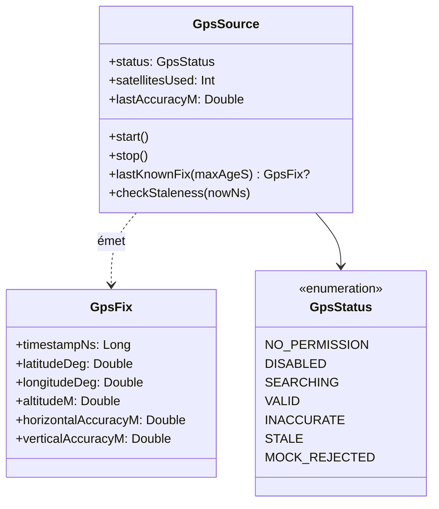
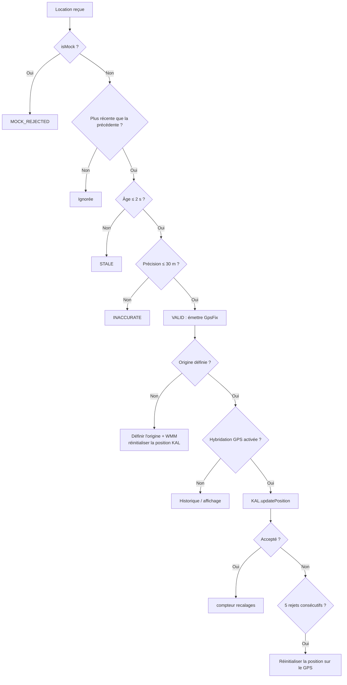

# CataNav — Spécification 03 : module GPS

| | |
|---|---|
| **Package** | `fr.inertialnav.iau.gps` |
| **Classes** | `GpsSource`, `GpsFix`, `GpsStatus` |
| **Paramètres** | `Params.Gps` |
| **Consommateurs** | Moteur → KAL (recalage de position), origine du plan tangent, IHM |

---

## 1. Rôle

Le module GPS fournit les positions GNSS **seulement si elles sont disponibles, activées, valides et rafraîchies**. Il sert à :

1. fixer l'**origine** du plan tangent local (premier fix valide, même si l'hybridation GPS est désactivée) ;
2. **recaler la position** dans KAL quand l'hybridation GPS est activée.

## 2. Description détaillée

### 2.1 Source

- Fournisseur : `LocationManager.GPS_PROVIDER`, interrogé **directement** (pas le Fused Location Provider). Mises à jour au rythme natif du récepteur (`minTime = 0`, `minDistance = 0`).
- Nombre de satellites utilisés : `GnssStatus.Callback`, pour l'affichage.
- Permission requise : `ACCESS_FINE_LOCATION`.

### 2.2 Critères d'acceptation d'une position

| Critère | Règle | Statut si échec |
|---|---|---|
| Disponible / activé | Permission accordée et `GPS_PROVIDER` activé | `NO_PERMISSION`, `DISABLED` |
| Non fictive | `location.isMock == false` | `MOCK_REJECTED` |
| Nouvelle | horodatage strictement supérieur au dernier accepté | (ignorée) |
| Rafraîchie | âge $= t_{now} - t_{fix} \le$ `MAX_AGE_S` (2 s) | `STALE` |
| Valide | précision horizontale annoncée $\le$ `MAX_ACCURACY_M` (30 m) | `INACCURATE` |

Le moteur appelle `checkStaleness()` à chaque tick (5 Hz) : un statut `VALID` passe à `STALE` si aucune position n'est arrivée depuis plus de 2 s.

### 2.3 Dernière position connue

Au démarrage, si aucune origine n'existe, `lastKnownFix()` interroge les fournisseurs GPS, fused et network. Il retient la position non fictive la plus précise de moins de `LAST_KNOWN_MAX_AGE_S` (300 s).

### 2.4 Exploitation par le moteur

- **Premier fix** : il définit l'origine $(\varphi_0, \lambda_0, h_0)$ du plan tangent et le modèle WMM local. Si le filtre tourne déjà, sa position est réinitialisée à l'origine.
- **Fix suivants** : conversion en NED, puis recalage KAL avec $\sigma_H = $ précision horizontale et $\sigma_V$ = précision verticale (ou $2\sigma_H$ si elle n'est pas fournie).
- **Rejets consécutifs** : après `MAX_CONSECUTIVE_REJECTS` (5) rejets d'affilée par le test du χ², la position du filtre est réinitialisée sur le GPS. Cela permet de se rattraper après une longue dérive en souterrain.

## 3. Équations

### 3.1 Conversion géodésique → plan tangent local NED (WGS84)

$$
M = \frac{a(1-e^2)}{(1-e^2\sin^2\varphi_0)^{3/2}}, \qquad
N = \frac{a}{\sqrt{1-e^2\sin^2\varphi_0}}
$$

$$
\begin{aligned}
x_N &= (\varphi - \varphi_0)\,(M + h_0)\\
x_E &= (\lambda - \lambda_0)\,(N + h_0)\cos\varphi_0\\
x_D &= -(h - h_0)
\end{aligned}
$$

(angles en radians ; $a = 6\,378\,137$ m, $e^2 = 6{,}694\,38\times10^{-3}$). L'inverse est utilisé pour la sortie.

### 3.2 Modèle de mesure (voir spécification 05)

$$
\mathbf z_{GPS} = \mathbf p_n + \mathbf v, \qquad
R = \mathrm{diag}(\sigma_H^2, \sigma_H^2, \sigma_V^2)
$$

## 4. Interfaces

| Sens | Élément | Contenu |
|---|---|---|
| Sortie | `onFix(GpsFix)` | horodatage, lat, lon, alt, $\sigma_H$, $\sigma_V$, vitesse, cap |
| Sortie | `status`, `satellitesUsed`, `lastAccuracyM` | Affichage IHM |
| Entrée | `checkStaleness(nowNs)` | Appel périodique du moteur |

## 5. Schéma architectural

## 6. Schéma de flux

## 7. Justifications

| Choix | Justification |
|---|---|
| `GPS_PROVIDER` direct | Le module LOC injecte des positions fictives dans le Fused Location Provider. Lire le GPS brut garantit qu'on n'hybride jamais la propre sortie de l'application (exigence G-4). |
| Rejet des `isMock` | Seconde protection contre la boucle LOC → GPS. |
| 30 m / 2 s | En milieu urbain dense ou en entrée de souterrain, les positions dégradées (multitrajets) sont fréquentes. Les écarter évite d'entraîner le filtre ; leur incertitude serait de toute façon peu informative. |
| Précision annoncée comme σ | La valeur `accuracy` d'Android correspond à un rayon de confiance de ~68 %, soit environ 1σ horizontal. |
| Origine fixée par le premier fix | Le plan tangent local est précis à mieux que 1 m sur quelques kilomètres, ce qui convient à l'échelle piéton. Une seule origine par session évite les discontinuités. |
| Réinitialisation après 5 rejets | Après une longue période sans GPS, l'incertitude réelle dépasse l'incertitude estimée et le test du χ² rejetterait indéfiniment les bonnes mesures. |

## 8. Limites et évolutions

- La vitesse et le cap GNSS ne sont pas utilisés comme mesures (amélioration possible du cap en marche).
- Le décalage entre l'instant de la mesure et son traitement n'est pas compensé (≤ quelques centaines de ms).
- Pas d'utilisation des mesures GNSS brutes (pseudo-distances), qu'Android expose pourtant.
