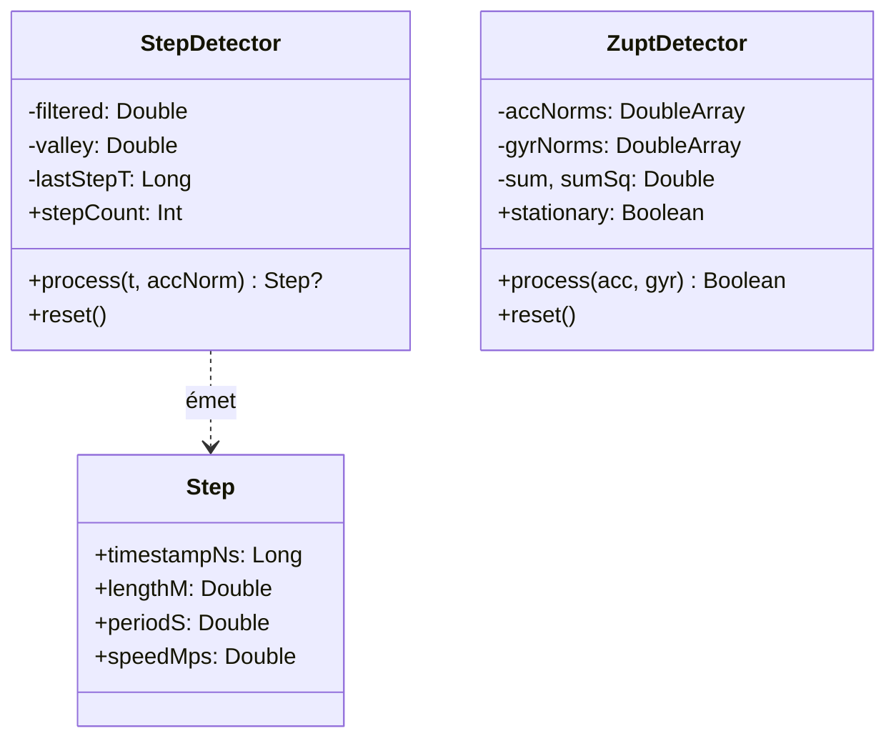
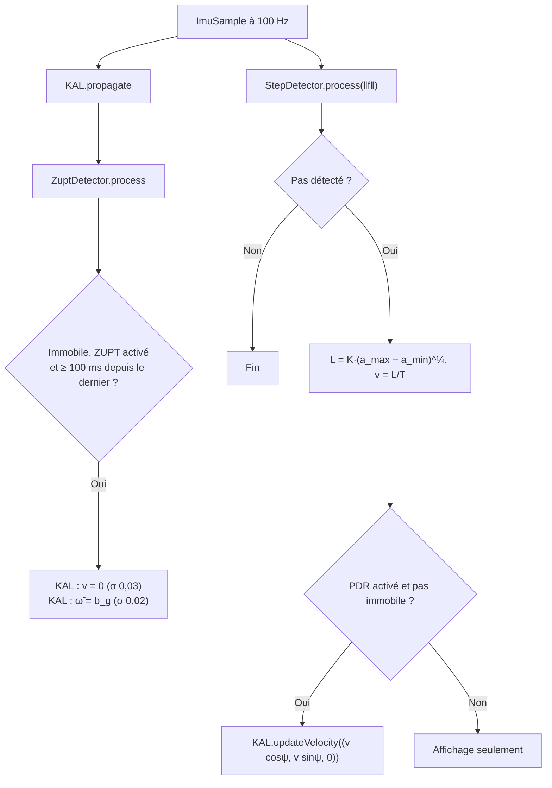

# CataNav — Spécification 04 : aides piéton (PDR et ZUPT)

| | |
|---|---|
| **Package** | `fr.inertialnav.iau.pedestrian` |
| **Classes** | `StepDetector`, `Step`, `ZuptDetector` |
| **Paramètres** | `Params.Pedestrian` |
| **Consommateurs** | Moteur → KAL (pseudo-mesures de vitesse) |

---

## 1. Rôle

La double intégration de l'accélération dérive en $t^2$ : en quelques dizaines de secondes, l'erreur de position d'un smartphone atteint plusieurs dizaines de mètres. Les aides piéton exploitent la **nature de la marche humaine** pour produire des pseudo-mesures qui bornent cette dérive :

| Aide | Principe | Mesure injectée dans KAL | Switch IHM |
|---|---|---|---|
| **PDR** (*Pedestrian Dead Reckoning*) | Chaque pas détecté donne une longueur et une durée, donc une vitesse | Vitesse NED $(v\cos\psi, v\sin\psi, 0)$ | « Détection de pas (PDR) » |
| **ZUPT** (*Zero velocity UPdaTe*) | À l'arrêt, la vitesse est nulle | $\mathbf v_n = \mathbf 0$ | « ZUPT » |
| **ZARU** (*Zero Angular Rate Update*) | À l'arrêt, le gyromètre ne mesure que son biais | $\tilde{\boldsymbol\omega} = \mathbf b_g$ | (lié à ZUPT) |

## 2. Détection de pas (`StepDetector`)

### 2.1 Algorithme

1. **Signal** : norme de la force spécifique $a_k = \lVert \tilde{\mathbf f}_k \rVert$ (indépendante de l'orientation du téléphone).
2. **Filtre passe-bas** du premier ordre, fréquence de coupure $f_c$ = `STEP_FILTER_CUTOFF_HZ` (3 Hz) :
$$
\bar a_k = \bar a_{k-1} + \frac{\Delta t}{RC + \Delta t}\,(a_k - \bar a_{k-1}), \qquad RC = \frac{1}{2\pi f_c}
$$
3. **Détection de pic** : un maximum local de $\bar a$ (passage de croissant à décroissant) est un pas s'il vérifie
$$
\bar a_{max} > g + \Delta a_{seuil} \quad (\Delta a_{seuil} = 1{,}2\ \text{m/s}^2)
\qquad\text{et}\qquad
t - t_{pas\,préc.} \ge T_{min} = 0{,}3\ \text{s}
$$
4. **Vallée** : le minimum $\bar a_{min}$ de $\bar a$ depuis le pas précédent est suivi en continu.

### 2.2 Longueur de pas : modèle de Weinberg

$$
L = K\,\sqrt[4]{\bar a_{max} - \bar a_{min}}, \qquad K = 0{,}47 \ (\texttt{WEINBERG\_K})
$$

### 2.3 Période et vitesse

$$
T = \begin{cases} t - t_{pas\,préc.} & \text{si } \le T_{max} = 2\ \text{s}\\ T_{déf} = 0{,}6\ \text{s} & \text{sinon (reprise de marche)}\end{cases}
\qquad
v = \frac{L}{T}
$$

### 2.4 Pseudo-mesure PDR

À chaque pas, si le PDR est activé et que le piéton n'est pas déclaré immobile :

$$
\mathbf z_{PDR} = \begin{pmatrix} v\cos\psi \\ v\sin\psi \\ 0 \end{pmatrix} = \mathbf v_n + \mathbf w,
\qquad
R = \mathrm{diag}(\sigma_H^2, \sigma_H^2, \sigma_V^2)
$$

$$
\sigma_H = 0{,}15 + 0{,}25\,v \ \ \text{(m/s)}, \qquad \sigma_V = 0{,}1\ \text{m/s}
$$

$\psi$ est le lacet estimé par KAL (direction de l'axe « avant » du téléphone).

## 3. Détection d'immobilité (`ZuptDetector`)

### 3.1 Critère

Sur une fenêtre glissante de $W$ = `ZUPT_WINDOW` = 25 échantillons (0,25 s) :

$$
\sigma_{\lVert f\rVert} = \sqrt{\frac{1}{W}\sum a_k^2 - \Big(\frac{1}{W}\sum a_k\Big)^2} < 0{,}25\ \text{m/s}^2
\qquad\text{et}\qquad
\max_k \lVert\tilde{\boldsymbol\omega}_k\rVert < 0{,}3\ \text{rad/s}
$$

Les sommes sont tenues à jour de façon incrémentale (tampon circulaire), avec un coût O(1) par échantillon pour l'écart-type.

### 3.2 Pseudo-mesures (au plus 10 Hz, `ZUPT_PERIOD_NS`)

$$
\text{ZUPT : } \ \mathbf 0 = \mathbf v_n + \mathbf w_v,\quad \sigma = 0{,}03\ \text{m/s}
\qquad\qquad
\text{ZARU : } \ \tilde{\boldsymbol\omega}_b = \mathbf b_g + \mathbf w_\omega,\quad \sigma = 0{,}02\ \text{rad/s}
$$

## 4. Interfaces

| Classe | Entrée | Sortie |
|---|---|---|
| `StepDetector.process(t, ‖f‖)` | horodatage, norme de la force spécifique | `Step?` (horodatage, longueur, période, vitesse) |
| `ZuptDetector.process(f, ω)` | force spécifique et vitesse angulaire FRD | `Boolean` (immobile) |

## 5. Schéma architectural

## 6. Schéma de flux

## 7. Justifications

| Choix | Justification |
|---|---|
| Norme de l'accélération | Indépendante de l'orientation du téléphone (main, poche), contrairement à un axe particulier. |
| Passe-bas 3 Hz | La cadence de marche est de 1,5 à 2,5 pas/s : 3 Hz conserve le motif du pas et élimine les chocs et vibrations. |
| Seuil g + 1,2 m/s² et intervalle ≥ 0,3 s | Rejette les petits mouvements de la main et les doubles détections d'un même pas (au plus 3,3 pas/s). |
| Modèle de Weinberg | Modèle empirique classique et robuste. Il relie l'amplitude du rebond vertical à la longueur du pas avec un seul paramètre à calibrer. |
| Vitesse plutôt que déplacement | Une mesure de vitesse s'intègre naturellement dans l'état du filtre. Le filtre combine ainsi la dynamique inertielle (fine) et la cadence des pas (sans dérive). |
| σ croissant avec la vitesse | L'erreur du modèle de Weinberg est relative (≈ 10–20 %) ; le terme constant couvre l'écart entre cap du téléphone et direction de marche. |
| Vitesse verticale nulle pendant la marche | Contraint le canal vertical, intrinsèquement instable en navigation inertielle pure. |
| ZUPT pas pendant un pas | Un pic de pas et une immobilité sont incompatibles ; l'immobilité est prioritaire. |
| Seuils ZUPT « main » | Un téléphone tenu en main n'est jamais parfaitement immobile (tremblement). Les seuils sont plus tolérants que pour un capteur fixé au pied. |
| ZARU avec ZUPT | À l'arrêt, le biais gyro devient directement observable : c'est le meilleur moyen de limiter la dérive de cap sans magnétomètre. |

## 8. Limites et évolutions

- **Hypothèse forte du PDR** : téléphone tenu devant soi, haut de l'écran dans le sens de marche. En poche ou au téléphone, la direction de marche diffère du lacet du téléphone ; il faudrait l'estimer séparément (ACP des accélérations horizontales).
- La constante $K$ dépend de la personne : prévoir une calibration (distance connue, ou GPS en surface).
- Escaliers et échelles : la vitesse verticale nulle est alors fausse. Une détection de montée (baromètre) serait utile.
- ZUPT peu fréquent en marche continue avec le téléphone en main (le pied, lui, s'arrête à chaque pas).

## 9. Vérification

- `PedestrianTest.detectsStepsOfSyntheticWalk` : 18 ± 1,5 pas détectés pour 10 s de marche synthétique à 1,8 Hz ; longueur moyenne 0,70 ± 0,1 m.
- `PedestrianTest.zuptDetectsStillnessOnly`.
- `InsEkfTest.zuptBoundsVelocityErrorWithAccelBias` : avec un biais accéléro de 5 cm/s², la vitesse reste < 2 cm/s sous ZUPT.
