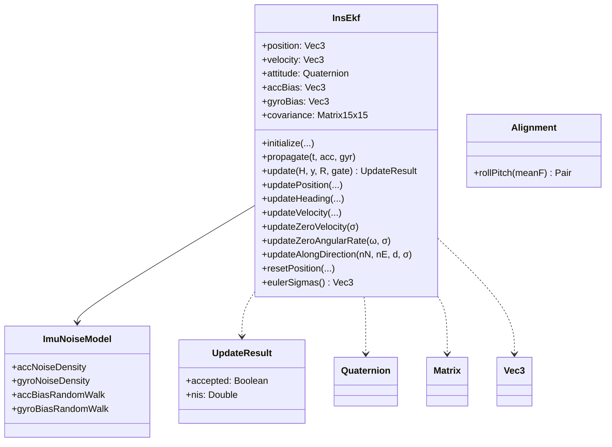
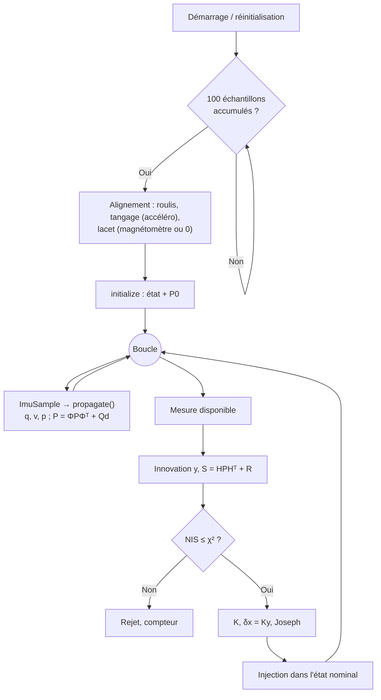

# CataNav — Spécification 05 : module KAL (navigation inertielle et filtre de Kalman)

| | |
|---|---|
| **Package** | `fr.inertialnav.iau.kal` |
| **Classes** | `InsEkf`, `ImuNoiseModel`, `UpdateResult`, `Alignment` |
| **Socle** | `core.math` (`Vec3`, `Matrix`, `Quaternion`), `core.geo.LocalTangentPlane` |
| **Paramètres** | `Params.Kal`, `Params.Physics` |

---

## 1. Rôle

KAL est le cœur de CataNav :

1. il **intègre** les mesures IMU pour propager la position, la vitesse et l'attitude (mécanisation *strapdown*) ;
2. il **estime** les erreurs de cette solution et les biais des capteurs par un **filtre de Kalman étendu à erreur d'état** (ES-EKF), à partir de toutes les mesures d'hybridation ;
3. il **rejette** les mesures incohérentes (test du χ²) ;
4. il fournit l'**incertitude** (covariance) de chaque grandeur.

## 2. État

### 2.1 État nominal

$$
\mathbf x = \big(\ \mathbf p_n \in \mathbb R^3,\ \ \mathbf v_n \in \mathbb R^3,\ \ q_{nb} \in \mathbb H,\ \ \mathbf b_a \in \mathbb R^3,\ \ \mathbf b_g \in \mathbb R^3\ \big)
$$

$\mathbf p_n$ : position NED relative à l'origine du plan tangent (m) ; $\mathbf v_n$ : vitesse NED (m/s) ; $q_{nb}$ : attitude ; $\mathbf b_a$, $\mathbf b_g$ : biais accéléromètre (m/s²) et gyromètre (rad/s) en repère porteur.

### 2.2 Vecteur d'erreur (15 états)

$$
\delta\mathbf x = \big(\ \delta\mathbf p,\ \delta\mathbf v,\ \boldsymbol\varphi,\ \delta\mathbf b_a,\ \delta\mathbf b_g\ \big) \in \mathbb R^{15}
$$

| Index | Composante | Définition |
|---|---|---|
| 0–2 | $\delta\mathbf p$ | $\mathbf p_{vrai} - \hat{\mathbf p}$ |
| 3–5 | $\delta\mathbf v$ | $\mathbf v_{vrai} - \hat{\mathbf v}$ |
| 6–8 | $\boldsymbol\varphi$ | petit angle en repère **nav** : $C_{nb}^{vrai} = (I + [\boldsymbol\varphi\times])\,\hat C_{nb}$ |
| 9–11 | $\delta\mathbf b_a$ | $\mathbf b_a^{vrai} - \hat{\mathbf b}_a$ |
| 12–14 | $\delta\mathbf b_g$ | $\mathbf b_g^{vrai} - \hat{\mathbf b}_g$ |

## 3. Initialisation (alignement statique grossier)

Pendant `Imu.ALIGNMENT_SAMPLES` (100) échantillons, soit environ 1 s **immobile**, la force spécifique est moyennée : $\bar{\mathbf f}_b$. Au repos, $\mathbf f_b = C_{bn}(0, 0, -g)^T$, d'où :

$$
\phi_0 = \mathrm{atan2}(-\bar f_y,\, -\bar f_z), \qquad
\theta_0 = \mathrm{atan2}\!\left(\bar f_x,\, \sqrt{\bar f_y^2 + \bar f_z^2}\right)
$$

Le cap initial $\psi_0$ vient du magnétomètre s'il est disponible et activé (spécification 02, §3.3), sinon $\psi_0 = 0$.

Position initiale : le dernier GPS de moins de 5 s si l'origine est connue, sinon la dernière position estimée (cas d'une réinitialisation). Biais initiaux nuls.

| Covariance initiale (1σ) | Valeur | Paramètre |
|---|---|---|
| Position H / V | précision GPS, sinon 10 m | `INIT_SIGMA_POS_*` |
| Vitesse | 0,1 m/s | `INIT_SIGMA_VEL` |
| Roulis, tangage | 2° | `INIT_SIGMA_ROLL_PITCH` |
| Lacet | 15° (magnétomètre) / 90° (sans) | `Msu.INITIAL_YAW_SIGMA_*` |
| Biais accéléro / gyro | 0,2 m/s² / 0,01 rad/s | `INIT_SIGMA_*_BIAS` |

## 4. Propagation

### 4.1 Mécanisation (état nominal)

Simplifications assumées à l'échelle piéton : rotation terrestre et *transport rate* négligés (15°/h, très inférieur au bruit d'un gyro MEMS), gravité constante, Terre localement plate.

Pour chaque échantillon IMU, $\Delta t = t_k - t_{k-1}$ (ignoré si $\le 0$ ou $> 0{,}2$ s) :

$$
\boldsymbol\omega = \tilde{\boldsymbol\omega} - \hat{\mathbf b}_g,\qquad \mathbf f = \tilde{\mathbf f} - \hat{\mathbf b}_a
$$

$$
q_{nb}^{+} = \mathrm{normalise}\!\Big(q_{nb} \otimes q\{\boldsymbol\omega\,\Delta t\}\Big),
\qquad
q\{\boldsymbol\theta\} = \Big(\cos\tfrac{\lVert\boldsymbol\theta\rVert}{2},\ \tfrac{\boldsymbol\theta}{\lVert\boldsymbol\theta\rVert}\sin\tfrac{\lVert\boldsymbol\theta\rVert}{2}\Big)
$$

$$
\mathbf f_n = \tfrac12\big(C_{nb}^{-} + C_{nb}^{+}\big)\,\mathbf f,
\qquad
\mathbf a_n = \mathbf f_n + \begin{pmatrix}0\\0\\g\end{pmatrix}
$$

$$
\mathbf p_n^{+} = \mathbf p_n + \mathbf v_n\,\Delta t + \tfrac12\,\mathbf a_n\,\Delta t^2,
\qquad
\mathbf v_n^{+} = \mathbf v_n + \mathbf a_n\,\Delta t
$$

### 4.2 Modèle d'erreur (temps continu)

$$
\begin{aligned}
\delta\dot{\mathbf p} &= \delta\mathbf v\\
\delta\dot{\mathbf v} &= -[\mathbf f_n\times]\,\boldsymbol\varphi - C_{nb}\,\delta\mathbf b_a - C_{nb}\,\mathbf w_a\\
\dot{\boldsymbol\varphi} &= -C_{nb}\,\delta\mathbf b_g - C_{nb}\,\mathbf w_g\\
\delta\dot{\mathbf b}_a &= \mathbf w_{ba}, \qquad \delta\dot{\mathbf b}_g = \mathbf w_{bg}
\end{aligned}
$$

### 4.3 Discrétisation

$$
\Phi = I_{15} + F\,\Delta t =
\begin{pmatrix}
I & I\Delta t & 0 & 0 & 0\\
0 & I & -[\mathbf f_n\times]\Delta t & -C_{nb}\Delta t & 0\\
0 & 0 & I & 0 & -C_{nb}\Delta t\\
0 & 0 & 0 & I & 0\\
0 & 0 & 0 & 0 & I
\end{pmatrix}
$$

$$
Q_d = \mathrm{diag}\big(\,0,\ \sigma_a^2\Delta t\,I,\ \sigma_g^2\Delta t\,I,\ \sigma_{ba}^2\Delta t\,I,\ \sigma_{bg}^2\Delta t\,I\,\big)
\qquad (C_{nb}C_{nb}^T = I)
$$

$$
P^{+} = \Phi\,P\,\Phi^T + Q_d \quad\text{(puis symétrisation)}
$$

| Densité | Valeur | Paramètre |
|---|---|---|
| $\sigma_a$ | 0,02 m/s²/√Hz | `ACC_NOISE_DENSITY` |
| $\sigma_g$ | 2·10⁻³ rad/s/√Hz | `GYRO_NOISE_DENSITY` |
| $\sigma_{ba}$ | 5·10⁻⁴ m/s³/√Hz | `ACC_BIAS_RANDOM_WALK` |
| $\sigma_{bg}$ | 5·10⁻⁵ rad/s²/√Hz | `GYRO_BIAS_RANDOM_WALK` |

## 5. Mise à jour

### 5.1 Forme générale

Pour une mesure linéarisée $\mathbf y = \mathbf z - h(\hat{\mathbf x}) \approx H\,\delta\mathbf x + \mathbf w$, $\mathbf w \sim \mathcal N(0, R)$ :

$$
S = HPH^T + R, \qquad
\text{NIS} = \mathbf y^T S^{-1}\mathbf y
$$

Si NIS > seuil χ² (à 0,1 % de risque : 10,83 ; 13,82 ; 16,27 pour 1, 2, 3 degrés de liberté), **la mesure est rejetée**. Sinon :

$$
K = PH^TS^{-1}, \qquad
\delta\hat{\mathbf x} = K\mathbf y, \qquad
P^{+} = (I - KH)\,P\,(I-KH)^T + KRK^T \quad\text{(forme de Joseph)}
$$

### 5.2 Injection et remise à zéro de l'erreur

$$
\mathbf p \mathrel{+}= \delta\hat{\mathbf p},\quad
\mathbf v \mathrel{+}= \delta\hat{\mathbf v},\quad
q_{nb} \leftarrow \mathrm{normalise}\big(q\{\hat{\boldsymbol\varphi}\} \otimes q_{nb}\big),\quad
\mathbf b_a \mathrel{+}= \delta\hat{\mathbf b}_a,\quad
\mathbf b_g \mathrel{+}= \delta\hat{\mathbf b}_g
$$

Le jacobien de remise à zéro est approché par l'identité (erreurs petites).

### 5.3 Catalogue des mesures

| Mesure | Origine | $\mathbf y$ | $H$ (blocs non nuls) | $R$ | Rejet |
|---|---|---|---|---|---|
| Position | GPS | $\mathbf z - \hat{\mathbf p}$ | $H_p = I_3$ | $\mathrm{diag}(\sigma_H^2,\sigma_H^2,\sigma_V^2)$ | χ²₃ |
| Cap | MSU | $\mathrm{wrap}(\psi_{mag} - \hat\psi)$ | $H_\varphi$ (§5.4) | $\sigma_\psi^2$ | χ²₁ |
| Vitesse PDR | Aides piéton | $\mathbf z - \hat{\mathbf v}$ | $H_v = I_3$ | $\mathrm{diag}(\sigma_H^2,\sigma_H^2,\sigma_V^2)$ | χ²₃ |
| ZUPT | Aides piéton | $-\hat{\mathbf v}$ | $H_v = I_3$ | $0{,}03^2 I$ | non |
| ZARU | Aides piéton | $\tilde{\boldsymbol\omega} - \hat{\mathbf b}_g$ | $H_{bg} = I_3$ | $0{,}02^2 I$ | non |
| Carte (1D) | Carte | $d$ (distance au réseau) | $H_p = (n_N, n_E, 0)$ | $1{,}5^2$ | χ²₁ |
| Position H (réservée) | — | $(z_N, z_E) - \hat{\mathbf p}_{NE}$ | $H_p$ partiel | $\sigma^2 I_2$ | χ²₂ |

### 5.4 Jacobien exact du cap

Avec $\psi = \mathrm{atan2}(C_{21}, C_{11})$ et $C^{vrai} = (I + [\boldsymbol\varphi\times])\hat C$ :

$$
H_\varphi = \frac{1}{C_{11}^2 + C_{21}^2}\begin{pmatrix} -C_{11}C_{31} & -C_{21}C_{31} & C_{11}^2 + C_{21}^2 \end{pmatrix}
$$

Ce jacobien reste exact quand le téléphone est incliné, contrairement à l'approximation $H_\varphi = (0, 0, 1)$. Le cap devient indéfini quand le tangage approche ±90° ($C_{11}^2 + C_{21}^2 \to 0$) : la mesure est alors ignorée.

### 5.5 Recalage carte à une dimension

Avec $\mathbf q$ le point praticable le plus proche (spécification 06), $\mathbf d = \mathbf q - \hat{\mathbf p}$, $d = \lVert \mathbf d_{NE}\rVert$, $\mathbf n = \mathbf d_{NE}/d$ :

$$
y = d = \mathbf n\cdot(\mathbf q - \hat{\mathbf p}), \qquad H = (n_N,\ n_E,\ 0,\ 0, \dots, 0)
$$

Seule la composante transversale à la galerie est observée.

## 6. Incertitudes d'attitude en angles d'Euler

La covariance d'attitude porte sur $\boldsymbol\varphi$ (repère nav). Pour l'affichage en roulis / tangage / lacet :

$$
\delta\boldsymbol\eta = J\,\boldsymbol\varphi, \qquad
J = E^{-1}(\phi,\theta)\;C_{bn}, \qquad
E^{-1} = \begin{pmatrix}
1 & \sin\phi\tan\theta & \cos\phi\tan\theta\\
0 & \cos\phi & -\sin\phi\\
0 & \sin\phi/\cos\theta & \cos\phi/\cos\theta
\end{pmatrix}
$$

$$
\Sigma_{\eta} = J\,P_{\varphi\varphi}\,J^T
$$

## 7. Interfaces

| Méthode | Rôle |
|---|---|
| `initialize(t, q, p, v, σ…)` | Initialisation de l'état et de la covariance |
| `propagate(t, f̃, ω̃)` | Mécanisation + propagation de la covariance |
| `update(H, y, R, gate)` | Mise à jour générique → `UpdateResult(accepted, nis)` |
| `updatePosition`, `updateHeading`, `updateVelocity`, `updateZeroVelocity`, `updateZeroAngularRate`, `updateAlongDirection`, `updateHorizontalPosition` | Mesures spécialisées (§5.3) |
| `resetPosition(p, σH, σV)` | Recalage brutal (décorrèle les états de position) |
| `position`, `velocity`, `attitude`, `euler`, `accBias`, `gyroBias`, `covariance`, `sigma(i)`, `eulerSigmas()` | Lecture de l'état |

## 8. Schéma architectural

## 9. Schéma de flux

## 10. Justifications

| Choix | Justification |
|---|---|
| **Filtre à erreur d'état** plutôt qu'EKF direct | L'erreur reste petite et quasi linéaire. L'attitude est un quaternion exact (pas de singularité), l'erreur un petit angle à 3 composantes : la covariance reste de dimension minimale (15) et bien conditionnée. Méthode de référence de la navigation hybridée. |
| Petit angle en repère **nav** | Le couplage vitesse/attitude s'écrit simplement ($-[\mathbf f_n\times]$) et le cap correspond directement à $\varphi_z$ quand le téléphone est à plat. |
| Biais en marches aléatoires | Modèle minimal pour des biais MEMS lentement variables (température) ; l'observabilité est apportée par ZUPT/ZARU, le GPS et le magnétomètre. |
| Force spécifique moyennée début/fin | Réduit l'erreur de *sculling* lors des rotations rapides sans coût notable. |
| Φ au premier ordre | À 100 Hz, $\lVert F\Delta t\rVert \ll 1$ : l'erreur de troncature est négligeable devant les incertitudes de modèle. |
| Forme de Joseph | Garantit une covariance symétrique définie positive malgré les arrondis, ce qui est essentiel pour un filtre qui tourne des heures. |
| Test du χ² sur la NIS | Rejet statistiquement fondé des mesures aberrantes (multitrajets GPS, perturbations magnétiques, mauvais appariement carte). |
| Terre plate, sans rotation terrestre | À l'échelle piéton (quelques km, vitesses < 2 m/s), les termes négligés valent moins de 10⁻⁴ m/s², bien en dessous du bruit capteur. |
| Mise à jour PDR en vitesse | Le pas fournit naturellement une vitesse moyenne ; la mesure est linéaire dans l'état. |

## 11. Limites et évolutions

- Le couplage entre la vitesse PDR et le lacet n'est pas linéarisé (la mesure est formée avec $\hat\psi$) : la vitesse PDR ne corrige donc pas le cap.
- Pas de compensation des retards de mesure (GPS, magnétomètre).
- Pas de facteurs d'échelle ni d'erreurs d'alignement des capteurs dans l'état.
- L'alignement suppose l'immobilité pendant 1 s ; un alignement en mouvement n'est pas prévu.
- Évolution possible : lisseur arrière (RTS) pour le post-traitement des trajets enregistrés.

## 12. Vérification

| Test | Vérifie |
|---|---|
| `staticPropagationStaysPut` | Pas de dérive avec des mesures parfaites (10 s, attitude quelconque) |
| `zuptBoundsVelocityErrorWithAccelBias` | Vitesse bornée sous ZUPT malgré un biais |
| `headingUpdateConvergesYaw` | Convergence du cap vers la mesure |
| `headingJacobianMatchesNumerical` | $H_\varphi$ exact (différences finies, 1e-5) |
| `eulerJacobianMatchesNumerical`, `eulerSigmasAtLevelMatchCovariance` | Conversion des incertitudes d'attitude |
| `gpsUpdateCorrectsPosition` | Mise à jour de position |
| `alongDirectionUpdateOnlyConstrainsCrossTrack` | Recalage carte 1D |
