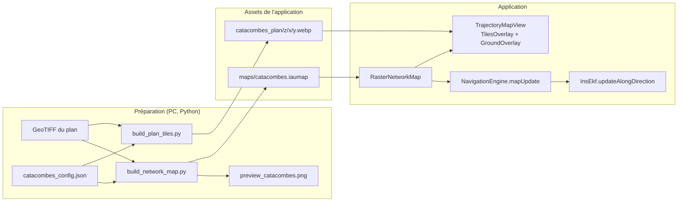
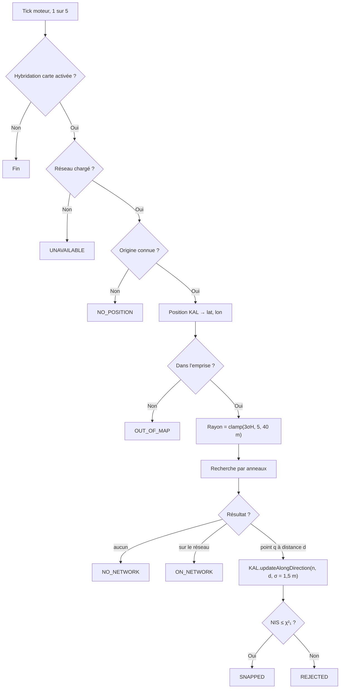

# CataNav — Spécification 06 : module Carte (hybridation et plan des catacombes)

| | |
|---|---|
| **Package** | `fr.inertialnav.iau.map` (application), `tools/map` (préparation sur PC) |
| **Classes** | `MapMatcher`, `MapMatch`, `RasterNetworkMap` ; outils `build_network_map.py`, `build_plan_tiles.py` |
| **Données** | `assets/maps/catacombes.iaumap` (réseau), `assets/catacombes_plan/z/x/y.webp` (plan) |
| **Source** | `Nexus alkhemia 2011_geo.tiff` (GeoTIFF WGS84, 6307 × 6307 px, ≈ 0,5 m/px) |
| **Paramètres** | `Params.Map`, `tools/map/catacombes_config.json` |

---

## 1. Rôle

1. **Hybridation carte** : maintenir la position estimée dans le **réseau praticable** (galeries, salles) en la recalant vers le point praticable le plus proche.
2. **Affichage** : fournir le plan des catacombes comme fond de carte hors ligne (onglet Carte) et le réseau praticable en surimpression.

## 2. Chaîne de préparation des données (sur PC)

### 2.1 Extraction du réseau praticable (`build_network_map.py`)

Le plan source est un document illustré, pas un fichier de tracés vectoriels. L'analyse du plan a mis en évidence plusieurs codes graphiques :

| Élément | Rendu | Traitement |
|---|---|---|
| Galerie étroite | deux parois grises neutres (~165), intérieur blanc | conservée : fermeture puis ouverture morphologiques |
| Galerie large / salle | parois grises, intérieur gris clair (~240–245) | conservée : remplissage + parois adjacentes |
| Rue de surface | trait gris clair (~230) | écartée (seuil de gris) |
| Texte | cœur foncé (< 110) ou bleu marine | écarté (masque dilaté) |
| Arcs décoratifs, limites | trait simple | écartés (l'ouverture élimine les traits simples) |
| Encarts « agrandissement », légende, titre, roses des vents | — | zones exclues (rectangles / cercles du JSON) |

Algorithme (pixels neutres : $\max(R,G,B) - \min(R,G,B) \le 14$, $v = \max(R,G,B)$) :

$$
\begin{aligned}
T &= \mathrm{dilate}\big(\{v < 110\},\, 7\big) &&\text{texte}\\
W &= \{110 \le v < 215\} \setminus T &&\text{parois}\\
F &= \mathrm{ouvre}\big(\{236 \le v \le 250\},\, 5\big) &&\text{intérieurs gris clair}\\
C &= \mathrm{ouvre}\big(\mathrm{ferme}(W, r=3),\, r=2\big) &&\text{galeries à double paroi}\\
P &= \mathrm{dilate}\big(C \cup (W \cap \mathrm{dilate}(F)),\, r=2\big) \cup F &&\text{praticable}
\end{aligned}
$$

Puis : marges et zones exclues mises à zéro, composantes connexes de moins de 400 px supprimées. Un aperçu (`preview_catacombes.png`) permet la validation visuelle.

### 2.2 Format `.iaumap`

Gros-boutiste (`DataOutputStream`) :

| Champ | Type | Contenu |
|---|---|---|
| magique | 8 octets | `IAUMAP01` |
| largeur, hauteur | int, int | 6307, 6307 |
| $\lambda_W$, $\varphi_N$ | double, double | bords ouest et nord du pixel (0, 0) |
| $\Delta\lambda$, $\Delta\varphi$ | double, double | taille d'un pixel (°) |
| nom | UTF | libellé de la carte |
| masque | gzip | bitset ligne par ligne, bit de poids fort en premier, lignes complétées à l'octet |

Taille : ≈ 320 Kio (5 Mo décompressés en mémoire).

### 2.3 Tuiles du plan (`build_plan_tiles.py`)

Pyramide XYZ Web Mercator 256 px, zooms 14 à 18, WebP avec transparence hors du plan (1443 tuiles, ≈ 8 Mio). Pour chaque pixel de tuile $(X, Y)$ au zoom $z$, $n = 2^z$ :

$$
\lambda = 360\,\frac{X}{256\,n} - 180, \qquad
\varphi = \arctan\!\Big(\sinh\!\big(\pi\,(1 - 2\tfrac{Y}{256\,n})\big)\Big)
$$

$$
c = \frac{\lambda - \lambda_W}{\Delta\lambda}, \qquad r = \frac{\varphi_N - \varphi}{\Delta\varphi}
$$

Échantillonnage bilinéaire (`cv2.remap`) ; pré-réduction par moyenne de zone pour les zooms faibles (anti-repliement). Résolution au zoom 18 : $\frac{2\pi a\cos\varphi}{256\cdot 2^{18}} \approx 0{,}39$ m/px, proche de la résolution source.

## 3. Appariement au réseau (`RasterNetworkMap`)

### 3.1 Géoréférencement

Le plan est en WGS84 géographique, pixels alignés sur les méridiens et parallèles :

$$
c = \Big\lfloor \frac{\lambda - \lambda_W}{\Delta\lambda} \Big\rfloor, \quad
r = \Big\lfloor \frac{\varphi_N - \varphi}{\Delta\varphi} \Big\rfloor, \qquad
\Delta x = \Delta\lambda\,\frac{\pi}{180}(N+h)\cos\varphi_c, \quad
\Delta y = \Delta\varphi\,\frac{\pi}{180}(M+h)
$$

($\Delta x \approx 0{,}503$ m, $\Delta y \approx 0{,}501$ m, évalués au centre du plan).

### 3.2 Recherche du point praticable le plus proche

Si le pixel courant est praticable, la position est déjà sur le réseau (`onNetwork`). Sinon, recherche par **anneaux carrés croissants** $k = 1, 2, \dots$ autour du pixel. Pour chaque pixel praticable $(r', c')$ :

$$
d = \sqrt{\big((c' + \tfrac12 - c_f)\,\Delta x\big)^2 + \big((r' + \tfrac12 - r_f)\,\Delta y\big)^2}
$$

($c_f, r_f$ : position fractionnaire). Arrêt dès que $(k-1)\min(\Delta x, \Delta y) > d_{min}$ ou que $k$ dépasse le rayon de recherche. Coût au pire $O(R^2)$ : ≈ 25 000 lectures de bits pour 40 m, négligeable à 1 Hz.

### 3.3 Recalage dans KAL (moteur, 1 Hz)

$$
R_{rech} = \mathrm{clamp}\big(3\,\sigma_H,\ 5\ \text{m},\ 40\ \text{m}\big), \qquad
\sigma_H = \sqrt{P_{NN} + P_{EE}}
$$

Si un point $\mathbf q$ hors du réseau est trouvé : mesure 1D $y = d$ selon $\mathbf n = (\mathbf q - \hat{\mathbf p})_{NE}/d$, avec $\sigma = 1{,}5$ m et un rejet χ²₁ (spécification 05, §5.5).

| État | Condition |
|---|---|
| `NO_POSITION` | origine inconnue (pas encore de GPS) |
| `OUT_OF_MAP` | position hors de l'emprise du plan |
| `ON_NETWORK` | position déjà dans le réseau : pas de correction |
| `SNAPPED` | recalage accepté |
| `NO_NETWORK` | aucun pixel praticable dans le rayon |
| `REJECTED` | recalage incohérent avec la covariance (χ²) |

## 4. Interfaces

| Élément | Contenu |
|---|---|
| `MapMatcher.covers(lat, lon)` | emprise |
| `MapMatcher.nearest(lat, lon, rayon)` | `MapMatch(position, distanceM, onNetwork)` ou `null` |
| `RasterNetworkMap.read(InputStream)` | chargement `.iaumap` |
| `RasterNetworkMap.downsample(f)` | masque réduit pour l'affichage |
| `NavigationEngine.networkMap` | `StateFlow` vers l'IHM (surimpression dorée) |

## 5. Schéma architectural

## 6. Schéma de flux (recalage)

## 7. Justifications

| Choix | Justification |
|---|---|
| Masque raster plutôt que graphe vectoriel | Le plan est une illustration ; une vectorisation fiable (squelette, topologie) est fragile sur ce document. Le masque se construit robustement, conserve la largeur réelle des galeries et des salles, et la recherche du plus proche voisin y est simple et exacte. |
| Zone praticable plutôt qu'axe de galerie | Le piéton peut se trouver n'importe où dans une salle ou une galerie large. Recaler sur l'axe introduirait une erreur systématique. |
| Pas de correction sur le réseau | La carte ne donne aucune information quand la position est déjà plausible. Corriger quand même rendrait le filtre faussement confiant. |
| Recalage 1D | La carte ne contraint que la direction transversale à la galerie. Une mesure 2D réduirait à tort l'incertitude le long de la galerie. |
| σ = 1,5 m | Demi-largeur typique d'une galerie (≈ 1 m) combinée à l'erreur de géoréférencement et d'extraction. |
| Rayon 3σ borné | Au-delà, l'appariement serait ambigu (galerie voisine). La borne basse évite de bloquer quand le filtre est très confiant. |
| 1 Hz | Les erreurs de carte sont fortement corrélées spatialement : des recalages plus fréquents compteraient plusieurs fois la même information. |
| Rejet χ² | Empêche le « saut » vers une galerie voisine quand la position a beaucoup dérivé. |
| Encarts exclus | Les agrandissements sont dessinés à une autre échelle et hors de leur position réelle : s'y recaler serait faux. |
| Tuiles WebP embarquées | Fonctionne sans réseau (sous terre), format natif d'osmdroid, compression ≈ 6 Ko/tuile. |

## 8. Limites et évolutions

- L'extraction est heuristique : galeries fragmentées par le texte, salle Z réelle mal captée. **Le résultat doit être validé visuellement** et les zones exclues ajustées (`catacombes_config.json`).
- Un seul niveau : les galeries superposées (deux niveaux) ne sont pas distinguées.
- Aucune topologie : le recalage peut accepter une galerie voisine parallèle si elle est dans le rayon et cohérente avec la covariance. Évolution possible : filtre particulaire contraint par le graphe des galeries.
- La qualité dépend du géoréférencement du GeoTIFF fourni.

## 9. Vérification

- `RasterNetworkMapTest.corridorSnapping` : distance exacte vers un couloir synthétique, respect du rayon.
- `RasterNetworkMapTest.ringSearchMatchesBruteForce` : recherche par anneaux identique à une recherche exhaustive (200 points aléatoires).
- `RasterNetworkMapTest.realCatacombMapLoads` : lecture du fichier réel, géoréférencement (coin NO 48,8483235 ; 2,3025517), pixel ≈ 0,50 m.
- Contrôle visuel : l'ossuaire de Denfert-Rochereau tombe vers 48,8306 N ; 2,3328 E sur les tuiles.
