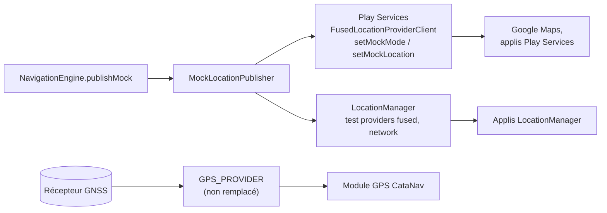
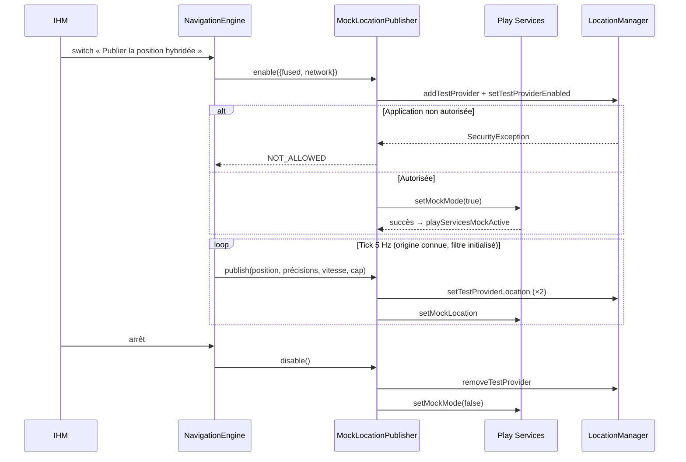

# CataNav — Spécification 07 : module LOC (fournisseur de localisation)

| | |
|---|---|
| **Package** | `fr.inertialnav.iau.loc` |
| **Classes** | `MockLocationPublisher`, `PublishedLocation`, `MockStatus` |
| **Paramètres** | `Params.Loc`, cadence : `Params.Engine.TICK_MS` |
| **Dépendance** | `com.google.android.gms:play-services-location` |

---

## 1. Rôle

LOC remplace, pour les autres applications du téléphone (Google Maps, etc.), la position GNSS par la **position hybridée** de CataNav.

## 2. Description détaillée

### 2.1 Mécanisme Android

Sans droits *root*, le seul moyen de fournir une position système est le mécanisme de **position fictive** (*mock location*). L'application doit être sélectionnée comme « application de position fictive » dans les options pour les développeurs (permission `ACCESS_MOCK_LOCATION`).

### 2.2 Deux canaux de publication

| Canal | API | Applications concernées |
|---|---|---|
| **Fused Location Provider de Google Play Services** | `FusedLocationProviderClient.setMockMode(true)` + `setMockLocation()` | Google Maps et la grande majorité des applications |
| **Fournisseurs de test du framework** | `LocationManager.addTestProvider()` + `setTestProviderLocation()` sur `FUSED_PROVIDER` et `NETWORK_PROVIDER` | Applications utilisant directement `LocationManager` |

`GPS_PROVIDER` n'est **jamais** remplacé : le module GPS y lit les vraies mesures (spécification 03). Le mode fictif de Play Services n'affecte pas les accès directs à `LocationManager`.

### 2.3 Contenu publié (à chaque tick, 5 Hz)

$$
(\varphi, \lambda, h) = \text{LTP}^{-1}(\hat{\mathbf p}_n), \qquad
v = \sqrt{\hat v_N^2 + \hat v_E^2}, \qquad
\chi = \mathrm{atan2}(\hat v_E, \hat v_N) \bmod 360°
$$

| Champ `Location` | Valeur |
|---|---|
| `accuracy` | $\max\big(\sqrt{P_{NN} + P_{EE}},\ 1\ \text{m}\big)$ |
| `verticalAccuracyMeters` | $\max(\sigma_D, 1\ \text{m})$ |
| `speed`, `speedAccuracyMetersPerSecond` | $v$, $\max\big(\sqrt{\sigma_{vN}^2 + \sigma_{vE}^2},\ 0{,}1\big)$ |
| `bearing` | $\chi$ |
| `bearingAccuracyDegrees` | $\mathrm{clamp}\big(\tfrac{180}{\pi}\,\sigma_v / v,\ 1°,\ 180°\big)$ si $v > 0{,}3$ m/s, sinon 180° (cap inconnu) |
| `time`, `elapsedRealtimeNanos` | instant de publication |

### 2.4 États

| État | Signification |
|---|---|
| `OFF` | publication désactivée |
| `ACTIVE` | fournisseurs de test installés, publication en cours |
| `NOT_ALLOWED` | application non sélectionnée comme application de position fictive (`SecurityException`) |
| `ERROR` | autre erreur |

`playServicesMockActive` indique en plus si le canal Play Services est effectif (il est indisponible sans Google Play).

## 3. Interfaces

| Méthode | Rôle |
|---|---|
| `enable(providers)` | Installe et active les fournisseurs de test, active le mode fictif Play Services |
| `publish(PublishedLocation)` | Publie une position sur tous les canaux actifs |
| `disable()` | Retire les fournisseurs de test, désactive le mode fictif (à l'arrêt de la navigation) |

## 4. Schéma architectural

## 5. Schéma de flux

## 6. Justifications

| Choix | Justification |
|---|---|
| Mode fictif Play Services | Google Maps lit sa position via le Fused Location Provider de Play Services, qui ignore les fournisseurs de test `fused`/`network` du framework. C'est le seul moyen pour que la position hybridée apparaisse dans Maps. |
| Pas de remplacement de `GPS_PROVIDER` | Remplacer le GPS couperait l'accès aux vraies mesures et créerait une boucle de rétroaction (exigence G-4). |
| Précisions issues de la covariance | Les applications clientes peuvent pondérer ou ignorer correctement la position ; Maps dessine le cercle d'incertitude. |
| Cap inconnu sous 0,3 m/s | À faible vitesse, la direction du vecteur vitesse n'a pas de sens. |
| 5 Hz | Fluide pour la navigation piétonne sans surcharger les clients. |
| Retrait à l'arrêt | Ne pas laisser le téléphone avec une position figée après l'arrêt de CataNav. |

## 7. Limites et évolutions

- Les applications qui lisent directement `GPS_PROVIDER` voient toujours la position GNSS réelle.
- Certaines applications détectent et refusent les positions fictives (`isMock`).
- Non vérifié sur appareil à ce jour : comportement de Play Services à confirmer sur la version installée.
