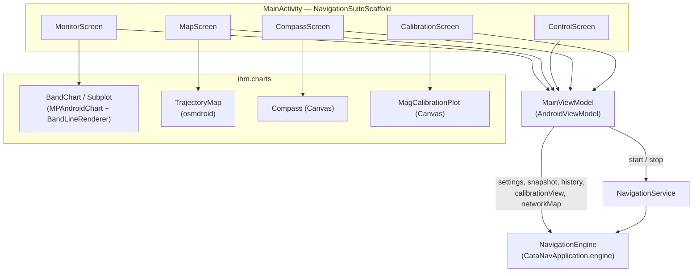
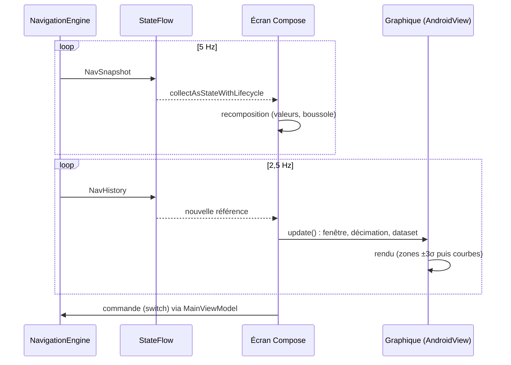

# CataNav — Spécification 08 : module IHM (interface homme-machine)

| | |
|---|---|
| **Package** | `fr.inertialnav.iau.ihm`, `ihm.charts`, `ui.theme` ; `MainActivity` |
| **Technologies** | Jetpack Compose (Material 3), MPAndroidChart, osmdroid, Canvas Compose |
| **Paramètres** | `Params.Ui` |

---

## 1. Rôle

L'IHM permet de :

1. **commander** la navigation et activer chaque hybridation (magnétomètre, GPS, carte), chaque aide piéton (PDR, ZUPT) et la publication LOC ;
2. **surveiller** graphiquement toutes les sorties de KAL avec leur incertitude ;
3. **visualiser** la trajectoire sur un fond OpenStreetMap ou sur le plan des catacombes ;
4. **orienter** l'utilisateur (boussole et verticale) ;
5. **calibrer** le magnétomètre avec un retour visuel en direct.

## 2. Écrans

Ordre des onglets : **Moniteur | Carte | Commande | Boussole | Calibration**. L'écran **Commande** s'ouvre au démarrage. La barre de navigation s'adapte à la taille de l'écran (`NavigationSuiteScaffold` : barre en bas sur téléphone, rail latéral sur tablette).

### 2.1 Commande (`ControlScreen`)

| Zone | Contenu |
|---|---|
| Bannière | Logo et titre « CATANAV » dans la charte du logo (voûte sombre, lueur et tracé dorés) |
| Navigation | État (arrêté / alignement / navigation), fréquences IMU et magnétomètre, Démarrer / Arrêter / Réinitialiser le filtre |
| Hybridations | Switchs Magnétomètre (azimut), GPS (lat, lon, alt), Carte (catacombes), avec état et compteurs |
| Aides piéton | Switchs PDR et ZUPT, avec nombre de pas, longueur, état d'immobilité |
| LOC | Switch de publication, état, nombre de positions publiées, état Play Services, accès aux options développeur |

### 2.2 Moniteur (`MonitorScreen`)

- Choix de la **fenêtre de temps** glissante (`Ui.TIME_WINDOWS_S` : 30 s à 10 min).
- Tableau de valeurs : latitude, longitude, altitude, σ, roulis/tangage, rejets.
- **Sous-graphes** : panneaux empilés, temps commun, axes alignés, enveloppe ±3σ en zone colorée transparente.

| Sous-graphe | Panneaux | ±3σ | Mesures superposées |
|---|---|---|---|
| Position | latitude, longitude, altitude | oui | points GPS |
| Attitude | roulis, tangage, lacet (0–360°) | oui | cap magnétomètre |
| Vitesse | Nord, Est, Descente | oui | — |
| Biais accéléromètres | X, Y, Z (m/s²) | oui | — |
| Biais gyromètres | X, Y, Z (mrad/s) | oui | — |
| Forces spécifiques | X, Y, Z (m/s²), 25 Hz | — | — |
| Vitesses angulaires | X, Y, Z (°/s), 25 Hz | — | — |

### 2.3 Carte (`MapScreen`)

Plein écran osmdroid :
- **fonds** au choix : Plan classique (OpenStreetMap) ou Catacombes (tuiles embarquées par-dessus OSM) ;
- **calques** : traces KAL (bleu) et GPS (rouge), position, cercle à 3σ, réseau d'hybridation (doré, optionnel) ;
- **bandeau d'état** : position, 3σ, état du recalage carte ;
- suivi automatique de la position, désactivé dès un déplacement manuel.

### 2.4 Boussole (`CompassScreen`)

Cadran lié au téléphone (haut du cadran = haut de l'écran) :
- **Nord KAL** : flèche bleue à l'angle $-\psi$, secteur ±3σ ;
- **Nord MSU** : flèche verte à $-\psi_{mag}$ (grise si perturbé) ;
- **Verticale** : projection de la direction « bas » dans le plan de l'écran. Disque = KAL avec ellipse ±3σ, anneau = accéléromètres. Cercles d'inclinaison à 30° et 60°.

Plus un tableau d'attitude (roulis, tangage, lacet ± 3σ, cap et état du magnétomètre, champ mesuré/attendu).

### 2.5 Calibration (`CalibrationScreen`)

Collecte (démarrer / terminer / annuler), résultat, calibration active (fer dur, fer doux, résidu), et **visualisation en direct** : projections XY, XZ, YZ des mesures brutes et corrigées, ellipse ajustée, sphère cible, mesure courante, barre de couverture de la sphère.

## 3. Équations de représentation

### 3.1 Enveloppes ±3σ

Pour une grandeur $x(t)$ d'écart-type $\sigma(t)$, la zone remplie est le polygone :

$$
\big\{(t_i,\, x_i + 3\sigma_i)\big\}_{i=1..n} \;\cup\; \big\{(t_i,\, x_i - 3\sigma_i)\big\}_{i=n..1}
$$

Latitude et longitude sont tracées **en écart** à une référence $x_{ref}$ (dernière valeur), réajoutée dans les libellés d'axe. Cela évite la quantification des flottants simple précision de MPAndroidChart (≈ 4·10⁻⁶ °, soit 0,4 m à 48° de latitude).

Les σ de latitude/longitude sont convertis des mètres en degrés : $\sigma_\varphi = \sigma_N / m_\varphi$, $\sigma_\lambda = \sigma_E / m_\lambda$ (mètres par degré à l'origine).

### 3.2 Boussole

Nord à l'angle écran $\alpha_N = -\psi$ (sens horaire depuis le haut). Secteur d'incertitude $[\alpha_N - 3\sigma_\psi,\ \alpha_N + 3\sigma_\psi]$.

Verticale estimée (repère FRD) et projection à l'écran (rayon utile $\rho$) :

$$
\mathbf d_b = C_{bn}\begin{pmatrix}0\\0\\1\end{pmatrix} = \begin{pmatrix}-\sin\theta\\ \sin\phi\cos\theta\\ \cos\phi\cos\theta\end{pmatrix},
\qquad
(x_{écran}, y_{écran}) = \big(c_x + \rho\,d_y,\ c_y - \rho\,d_x\big)
$$

Inclinaison : $\arccos(d_z)$. Demi-axes de l'ellipse ±3σ :

$$
a_x = \rho\,|\cos\phi\cos\theta|\cdot 3\sigma_\phi, \qquad a_y = \rho\,|\cos\theta|\cdot 3\sigma_\theta
$$

### 3.3 Calibration

Ellipse ajustée dans le plan $(i, j)$ : centre $(b_i, b_j)$, demi-axes $R/S_{ii}$ et $R/S_{jj}$ ; sphère cible de rayon $R$ centrée à l'origine.

## 4. Schéma architectural

## 5. Schéma de flux

## 6. Justifications

| Choix | Justification |
|---|---|
| Compose + StateFlow | Les écrans sont des fonctions de l'état publié. `collectAsStateWithLifecycle` arrête la collecte quand l'écran n'est pas visible (économie d'énergie). |
| Instantanés immuables | Aucun accès concurrent à l'état du filtre depuis le thread d'interface. |
| MPAndroidChart | Choix utilisateur ; performant pour des séries de milliers de points. Il est intégré par `AndroidView`, avec un rendu personnalisé pour remplir l'enveloppe entre +3σ et −3σ, ce que la bibliothèque ne sait pas faire seule. |
| Décimation à 600 points par courbe | Au-delà, la résolution de l'écran est dépassée et le rendu ralentit. |
| Sous-graphes à axe vertical de largeur fixe | Alignement des axes de temps entre panneaux, comme un *subplot*. |
| Interactions tactiles désactivées sur les courbes | Le défilement est piloté par la fenêtre de temps ; cela évite aussi les conflits avec le défilement vertical de l'écran. |
| osmdroid | Fond OpenStreetMap sans clé d'API et tuiles hors ligne embarquées (plan des catacombes). |
| Boussole liée au téléphone | L'utilisateur lit directement où est le Nord par rapport à son appareil, sans transformation mentale. |
| Verticale en « bille » | Représentation intuitive de l'inclinaison (niveau à bulle inversé), et cohérente avec l'affichage des deux sources (KAL / accéléromètre). |
| Charte graphique du logo | Identité visuelle cohérente (palette relevée sur le logo : #151314, #6C5846, #F7EBD9, #F8BE48). |

## 7. Limites et évolutions

- Textes en dur dans le code (pas encore dans `strings.xml`) : pas de traduction possible.
- Pas d'écran de réglage des paramètres en cours d'exécution (modification de `Params.kt` puis recompilation).
- Pas d'enregistrement ni d'export des trajets.

## 8. Vérification

L'IHM n'a pas de tests automatisés ; elle se vérifie sur appareil. Points de contrôle : défilement des courbes, zones ±3σ, alignement des panneaux, bascule des fonds de carte, cohérence boussole/attitude, retour visuel de la calibration.
