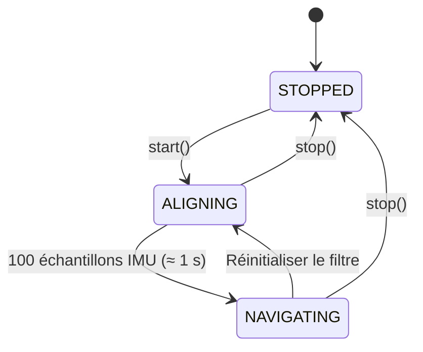
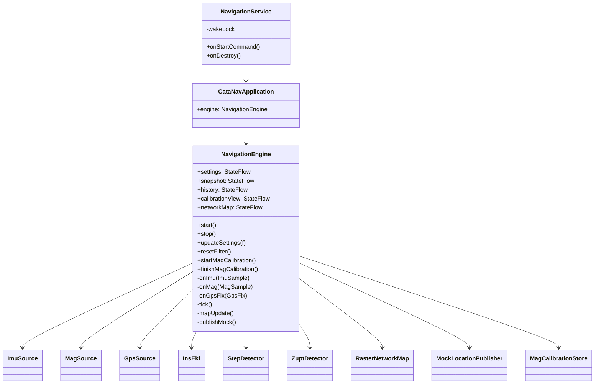
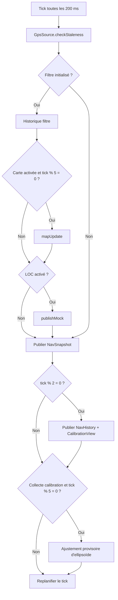

# CataNav — Spécification 09 : moteur de navigation et service

| | |
|---|---|
| **Packages** | `fr.inertialnav.iau.engine`, `fr.inertialnav.iau.service` ; `CataNavApplication` |
| **Classes** | `NavigationEngine`, `HybridationSettings`, `NavSnapshot`, `NavHistory`, `CalibrationView`, `NavigationService` |
| **Paramètres** | `Params.Engine` (et sections des modules orchestrés) |

---

## 1. Rôle

Le moteur **orchestre** tous les modules : il reçoit les mesures (IMU, MSU, GPS), applique les aides et les hybridations activées par l'utilisateur, fait tourner KAL, publie la position (LOC) et produit les données de l'IHM. Le service maintient cette chaîne active en arrière-plan.

## 2. Description détaillée

### 2.1 Cycle de vie

| Étape | Action |
|---|---|
| `NavigationService.onStartCommand` | Notification au premier plan (type `location`), verrou de veille partiel, `engine.start()` |
| `engine.start()` | Création du thread « catanav-nav » ; nouvelle session (origine effacée) ; démarrage IMU, MSU, GPS ; dernière position connue → origine ; application des réglages ; premier tick |
| Navigation | Callbacks capteurs et ticks sur le thread de navigation |
| `engine.stop()` | Arrêt des capteurs, retrait de LOC, `quitSafely()` du thread |
| Action « Arrêter » de la notification | `stopSelf()` → `onDestroy` → `engine.stop()` |

### 2.2 Phases du filtre

### 2.3 Traitements événementiels

| Événement | Cadence | Traitements |
|---|---|---|
| `onImu` | 100 Hz | historique IMU (25 Hz) ; alignement ou propagation ; ZUPT/ZARU (≤ 10 Hz) ; détection de pas et PDR |
| `onMag` | 50 Hz | collecte de calibration ; traînée ; compensation ; cap ; recalage de cap (≤ 10 Hz) après tests de perturbation |
| `onGpsFix` | ~1 Hz | origine ; historique GPS ; recalage de position ; réinitialisation après 5 rejets |
| `tick` | 5 Hz (200 ms) | fraîcheur GPS ; historique filtre ; recalage carte (1 Hz) ; publication LOC ; instantané IHM ; historique et vue de calibration (2,5 Hz) ; ajustement provisoire de calibration (1 Hz) |

### 2.4 Réglages utilisateur (`HybridationSettings`)

`magEnabled`, `gpsEnabled`, `mapEnabled`, `pdrEnabled`, `zuptEnabled`, `mockEnabled`. Les réglages sont modifiables à tout moment depuis l'IHM (`MutableStateFlow`). Leur application (LOC, chargement de la carte) est postée sur le thread de navigation.

### 2.5 Sorties vers l'IHM

| Flux | Contenu | Cadence |
|---|---|---|
| `snapshot: StateFlow<NavSnapshot>` | état complet : phase, position, vitesse, attitude, σ, biais, états GPS/MSU/carte/LOC, piéton, calibration | 5 Hz |
| `history: StateFlow<NavHistory>` | séries temporelles (10 min) : filtre à 5 Hz, IMU à 25 Hz, positions GPS | 2,5 Hz |
| `calibrationView` | nuage de calibration, traînée, ajustements, couverture | 2,5 Hz |
| `networkMap` | réseau praticable chargé | à la demande |

Les historiques sont des **tampons circulaires** (`DoubleRing`) de taille fixe, copiés en tableaux immuables à chaque publication.

## 3. Équations propres au moteur

### 3.1 Origine et cap magnétique local

À la première position valide : $\text{LTP}(\varphi_0, \lambda_0, h_0)$ et modèle WMM $(F, I, D)$ en ce point (spécifications 02 et 03).

### 3.2 Incertitude horizontale

$$
\sigma_H = \sqrt{P_{NN} + P_{EE}}
$$

utilisée par LOC (précision publiée), la carte (rayon de recherche) et l'IHM (cercle à 3σ).

### 3.3 Historique IMU décimé

$$
\bar{\mathbf f}_j = \frac{1}{4}\sum_{k=4j}^{4j+3}\tilde{\mathbf f}_k, \qquad
\bar{\boldsymbol\omega}_j = \frac{1}{4}\sum_{k=4j}^{4j+3}\tilde{\boldsymbol\omega}_k
$$

## 4. Schéma architectural

## 5. Schéma de flux (tick)

## 6. Justifications

| Choix | Justification |
|---|---|
| Un seul thread de navigation | Le filtre de Kalman exige des mises à jour atomiques de l'état et de la covariance. Un thread unique supprime toute course critique sans verrou et garantit l'ordre chronologique des traitements. |
| Moteur porté par l'`Application` | Partagé entre le service (cycle de vie) et l'IHM (affichage) ; il survit aux recréations d'activité (rotation d'écran). |
| Service au premier plan de type `location` | Exigé par Android pour accéder à la localisation et garder les capteurs actifs en arrière-plan ; la notification informe l'utilisateur. |
| Verrou de veille partiel | Sans lui, le processeur s'endort écran éteint et les capteurs non « wake-up » cessent d'être lus. |
| Tick 5 Hz séparé des capteurs | Découple les sorties (IHM, LOC) du rythme des capteurs : charge constante et prévisible. |
| Historique publié à 2,5 Hz | Défilement fluide des courbes sans recréer les jeux de données trop souvent. |
| Nouvelle origine à chaque session | Évite d'utiliser une origine lointaine d'une session précédente ; la précision du plan tangent reste maximale. |

## 7. Limites et évolutions

- Pas d'enregistrement des mesures brutes pour un rejeu hors ligne (utile pour régler les paramètres).
- Le service redémarre « à la main » (`START_NOT_STICKY`) : pas de reprise automatique après un arrêt par le système.
- Consommation : 100 Hz de capteurs + filtre 15 états en continu ; à mesurer sur appareil.
